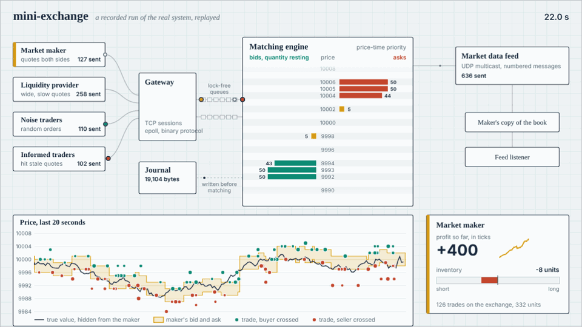

# matchbox-mini-exchange

A small electronic exchange in C++20, with a market maker trading on it.

*A recording of the real programs, played back. Each dot is one message the
exchange logged: orders going in, fills coming back, trades going out on the
feed. [Interactive version](docs/visualization/index.html) with pause, speed
and scrubbing (open the file locally, or serve `docs/` with GitHub Pages).*

It is the same shape as a real venue, at small scale: clients send orders over
TCP in a binary protocol, a single-threaded matching engine runs a price-time
priority limit order book, fills come back over TCP, and market data goes out
over UDP multicast. Every input is journaled first, so the exchange rebuilds
its book after a crash. A market-making strategy (Avellaneda-Stoikov) runs
live against the exchange, in a deterministic backtest on the same engine,
and against a replay of real NASDAQ order flow.

No frameworks: sockets, `epoll`, the wire protocol, the lock-free queues and
the order book are all written by hand. Linux only.

## What is in here

| Component | File | What it does |
|---|---|---|
| Order book | `include/mx/order_book.hpp` | Price-time priority, pool-allocated, no heap allocation on the hot path |
| Matching engine | `include/mx/engine.hpp` | Validation, ownership, order ids, execution reports, market data events. Deterministic |
| Wire protocol | `include/mx/protocol.hpp` | Fixed-width little-endian binary messages, 8 to 32 bytes |
| Gateway | `src/exchange_main.cpp` | Non-blocking TCP + `epoll`, stream framing, per-session output buffering |
| Thread hand-off | `include/mx/spsc_queue.hpp` | Lock-free single-producer/single-consumer ring buffers |
| Journal | `include/mx/journal.hpp` | Write-ahead log with group commit, replay on start-up |
| Market data | `include/mx/md.hpp` | UDP multicast, sequence numbers, gap detection |
| Client library | `include/mx/client.hpp`, `l2_book.hpp` | Order entry session, book rebuilt from the feed |
| Strategy | `include/mx/strategy.hpp` | Avellaneda-Stoikov quoting, EWMA volatility |
| Live market maker | `src/mm_client.cpp` | The strategy as an exchange client, with a quote state machine |
| Flow simulator | `src/flow_client.cpp` | Liquidity provider, noise traders, informed traders |
| Backtest | `src/backtest.cpp` | The strategy against a simulated market, in-process |
| Market data replay | `src/replay.cpp` | A real NASDAQ day (LOBSTER) through the engine, checked against the exchange's own book |
| Load generator | `src/loadgen.cpp` | Throughput and round-trip latency percentiles |
| Benchmarks | `bench/` | Book vs a `std::map` baseline; binary vs protobuf vs gRPC |
| Visualization | `docs/visualization/` | Plays back a recorded run: message flow, the order book, price and the maker's position |

## Build and run

    cmake -B build && cmake --build build -j
    ctest --test-dir build                 # unit + randomized tests

    bash scripts/run_demo.sh 30            # exchange + participants + market maker for 30 s
    ./build/mx_backtest --out out          # strategy research sweeps
    python3 scripts/plot_backtest.py out docs/img

    # real data: unzip the AMZN level-10 sample from https://lobsterdata.com into data/
    ./build/mx_replay --mm --out out/replay \
        --messages data/AMZN_2012-06-21_34200000_57600000_message_10.csv \
        --orderbook data/AMZN_2012-06-21_34200000_57600000_orderbook_10.csv

By hand, in separate terminals:

    ./build/mx_exchange --journal out/journal.bin
    ./build/mx_md_listener
    ./build/mx_flow
    ./build/mx_mm --gamma 0.05
    ./build/mx_loadgen --n 200000 --window 1     # latency
    ./build/mx_loadgen --n 1000000 --window 512  # throughput
    ./build/bench_order_book                     # book alone; --impl naive for the baseline
    ./build/bench_wire                           # binary vs protobuf vs gRPC (if installed)

Kill the exchange and start it again with the same `--journal`: it replays
the log and comes back with the same book and the same order ids.

## Results so far

Measured in a 2-vCPU shared cloud VM over loopback, with every process
competing for the same two cores. Treat them as a baseline to beat on real
hardware. Method and full tables in [docs/benchmarks.md](docs/benchmarks.md).

| Measurement | Result |
|---|---|
| Order book alone (add/cancel mix) | 32 M ops/s; p50 61 ns, p99 415 ns per operation |
| Same workload on a `std::map` + `std::list` book | 6 M ops/s |
| Order -> ack round trip over TCP, one order in flight | p50 25 us, p99 89 us |
| Sustained throughput over TCP, journal and market data on | 1.9 M requests/s (2.7 M with `--spin`) |
| Journal replay | 500,000 commands in 24 ms |
| Same round trip through gRPC instead of the binary protocol | 3.6x slower (unary), 2.1x slower (streaming) |

One optimization came straight from a flame graph: on a sparse book 63% of
the time went to walking empty price levels. A bitmap of non-empty levels
took that case from 4.8 M to 25.8 M ops/s. Two other profile-driven ideas
made no measurable difference and are written up as such.

Replaying a real day (AMZN, 21 June 2012, 269,747 events from the LOBSTER
sample): after every event all 10 levels of our book matched the exchange's
reconstruction, with levels first entering the 10-level window taken from
the data, and 91.75% of the 8,974 real executions hit the order our
price-time priority picks.

Strategy research is in [docs/research-note.md](docs/research-note.md).

- On simulated flow, inventory skew at gamma = 0.05 cut the standard
  deviation of hourly PnL by 86% for an 18% lower mean.
- On the real day the same strategy lost money in all 20 configurations
  tested (the best was flat). Fills earned 2 to 6 cents per share against
  the mid and were worth about minus 2 to 3.5 cents a minute later: real
  order flow is far more informed than the simulated flow. The note treats that as the main
  finding.

## Re-recording the animation

The animation is data, not a drawing. To record a new run and rebuild it:

    bash scripts/record_demo.sh 45         # runs the system with tracing on, writes docs/visualization/recording.js
    node scripts/capture_gif.js 22 14      # renders frames with Playwright, assembles docs/img/exchange.gif with ffmpeg

`mx_exchange --trace` logs every command, ack, fill, cancel and trade on the
engine thread; `mx_mm --events` and `mx_flow --events` log the maker's state
and the simulated true value. All three share one monotonic clock.

## Documentation

- [docs/architecture.md](docs/architecture.md): threads, queues, the life of an order
- [docs/protocol.md](docs/protocol.md): wire formats for order entry and market data
- [docs/design-decisions.md](docs/design-decisions.md): each choice and what was rejected
- [docs/benchmarks.md](docs/benchmarks.md): numbers, method, how to profile
- [docs/research-note.md](docs/research-note.md): the market-making study

## Roadmap

- [x] M1 Order book, tests, baseline benchmark
- [x] M2 Binary protocol, epoll gateway, client, load generator
- [x] M3 UDP market data with gap detection, journal and crash recovery
- [x] M4 Avellaneda-Stoikov market maker: live client and backtest, research note
- [x] M5 Performance study: flame graphs, data-structure comparison, bitmap
      optimization, cachegrind, binary vs protobuf vs gRPC
- [ ] M5b Repeat on real hardware: hardware counters, `isolcpus`, kernel-path experiments
- [x] M6 Replay real market data (LOBSTER) through the engine, with the market maker
- [ ] M6b Order-flow signal in the reference price; more stock-days; fees and rebates
- [x] M7 Animated visualization of the exchange, from a recorded run

Known gaps, on purpose: one instrument; no cancel-on-disconnect; no snapshot
channel, so a feed subscriber that joins late or loses a datagram cannot fully
rebuild depth; execution reports for an offline client are dropped, not
stored; the exchange is threads in one process, not separate processes over
shared memory.
