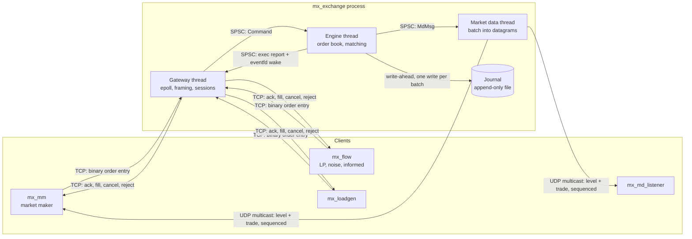

# Architecture

## Processes and threads

Three threads, and each piece of state has exactly one owner:

| Thread | Owns | Blocks on |
|---|---|---|
| Gateway | every socket, per-session buffers, client-id to session map | `epoll_wait` |
| Engine | the order book, order ids, the journal file | nothing (polls its queue, backs off when idle) |
| Market data | the UDP socket and the feed sequence number | nothing (same) |

The threads share nothing except three lock-free single-producer /
single-consumer ring buffers. The matching path takes no lock and makes no
heap allocation.

## Life of an order

1. The client writes a 28-byte `NewOrder` to its TCP socket.
2. The gateway's `epoll_wait` returns. It `recv()`s whatever bytes are
   available, frames complete messages using the length in each header,
   stamps the session's client id on the order and pushes a `Command` onto
   the inbound queue.
3. The engine thread pops a batch of up to 256 commands and writes the whole
   batch to the journal with one `write()` before touching the book.
4. For each command it validates, assigns an exchange order id, sends the
   ack, and matches against the opposite side in price-time order. Each fill
   produces a report for the maker, a report for the taker and a public
   trade. Each price level that changed produces one level update. Any
   remainder rests in the book (GTC) or is cancelled (IOC, market).
5. Reports go on the outbound queue. After the batch, the engine writes to an
   `eventfd` that sits in the gateway's epoll set.
6. The gateway wakes, moves each report into its session's output buffer, and
   does one `send()` per session. If the kernel buffer is full it keeps the
   rest and subscribes to `EPOLLOUT`.
7. In parallel the market data thread packs up to 64 feed messages into a
   datagram, stamps the sequence number and sends it to the multicast group.

## Determinism, recovery, backtesting

The engine's output depends only on the sequence of commands applied to it:
no clocks, no randomness, no thread timing. Two things follow.

- **Recovery.** On start-up the exchange replays the journal through a fresh
  engine with output switched off. The book, the free-slot order and the id
  generation counter all come back identical, so order ids clients already
  hold are still valid. `tests/test_engine.cpp` checks this on 300,000 random
  commands, including a torn record at the end of the file.
- **Backtesting.** `mx_backtest` links the same `Engine` and drives it
  in-process with a simulated clock. The strategy is tested against the real
  matching rules (queue position, partial fills, IOC behaviour), not a
  re-implementation of them.

## Backpressure

| Queue full | What happens |
|---|---|
| Inbound (gateway -> engine) | Gateway spins, draining outbound reports while it waits so the two threads cannot deadlock |
| Outbound (engine -> gateway) | Engine wakes the gateway and spins |
| Market data (engine -> publisher) | Engine spins. A production venue would drop and let receivers see a gap; without a snapshot channel a gap here is unrecoverable, so the demo blocks |
| A client that stops reading | Its output buffer grows to 64 MB, then the session is closed |
