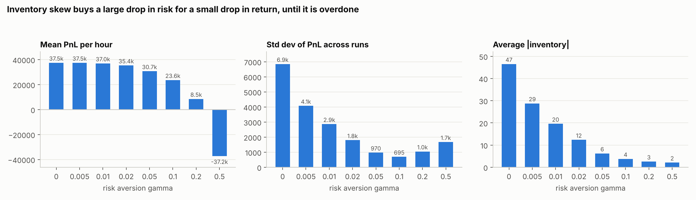
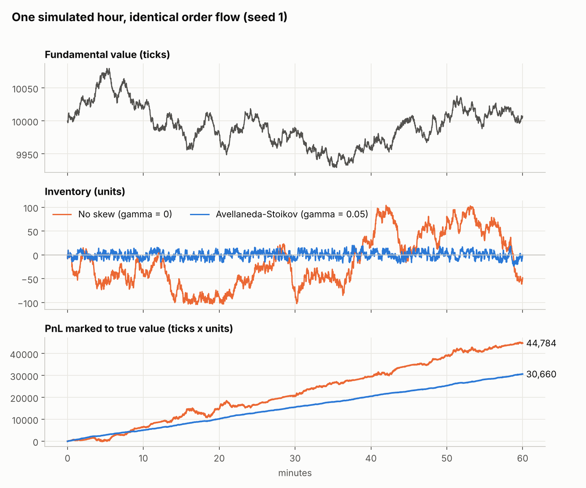
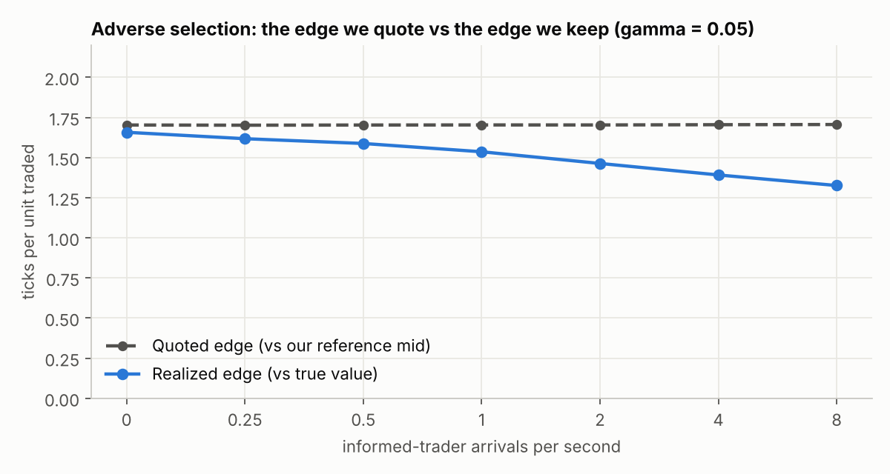
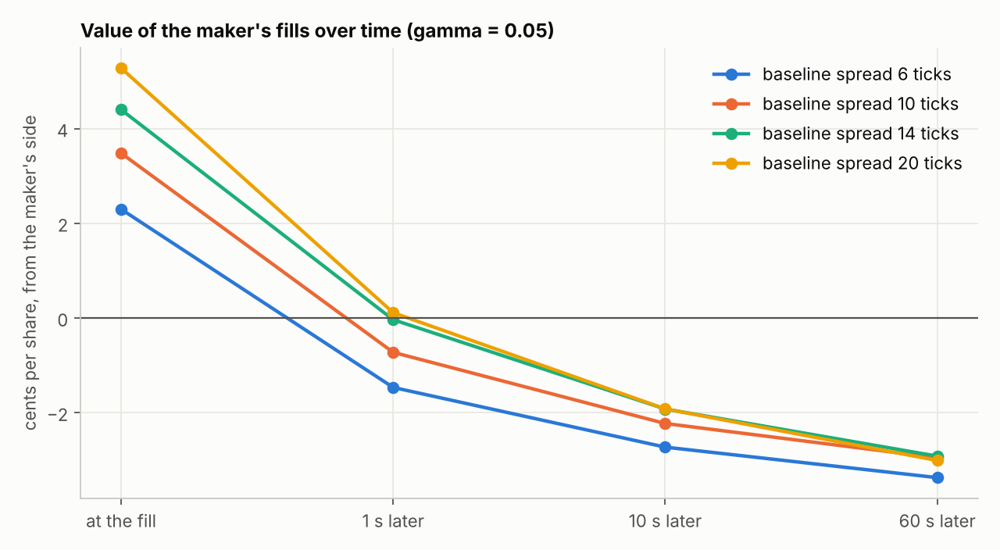
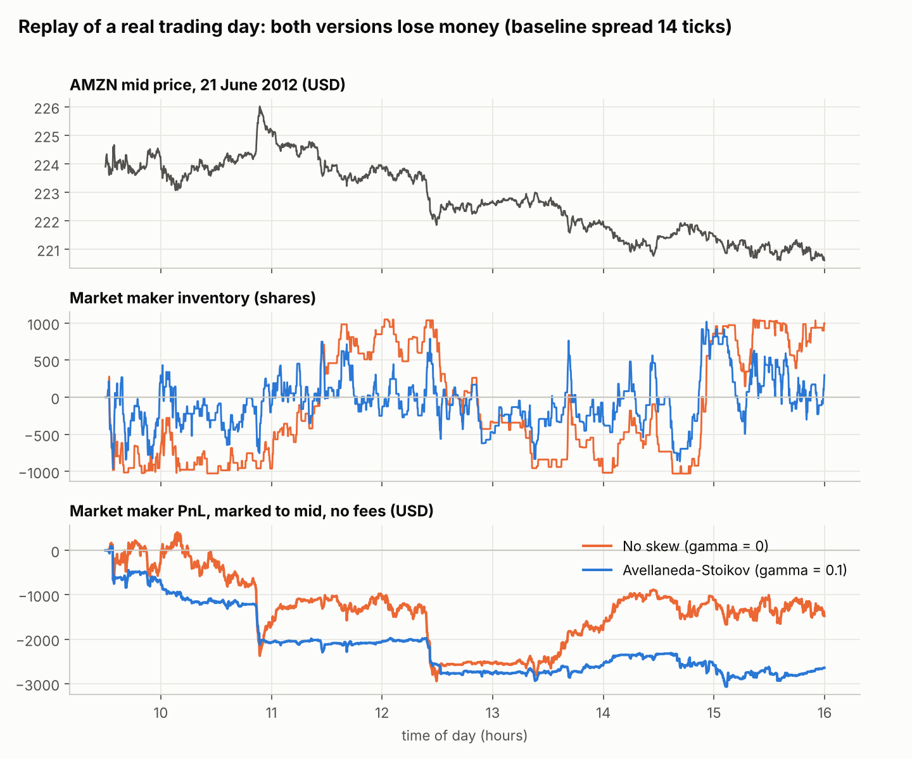

# Market making on a simulated limit order book: inventory risk and adverse selection

## Question

A market maker quotes a bid and an ask and earns the spread when both trade.
Two things take that profit away. Inventory risk: fills arrive unevenly, the
maker ends up long or short, and the price moves. Adverse selection: the
traders who hit a quote are disproportionately the ones who know it is wrong.

This note measures both on the mini-exchange, using the Avellaneda-Stoikov
(2008) model to control inventory, and asks how much return has to be given
up to control risk.

Results 1 to 3 are from a simulated market and describe that model. Result 4
replays one real trading day, and it reverses the headline: the strategy that
looks profitable in simulation loses money on real order flow.

## Strategy

With mid price s, signed inventory q, mid variance sigma^2 per second, risk
horizon tau, risk aversion gamma and fill-intensity decay k:

    reservation price   r = s - q * gamma * sigma^2 * tau
    total spread        d = gamma * sigma^2 * tau + (2 / gamma) * ln(1 + gamma / k)

The maker quotes r - d/2 and r + d/2, rounded to the nearest tick. When it is
long, both quotes shift down, so it becomes more likely to sell than to buy.
As gamma goes to 0 this becomes a symmetric quoter with spread 2/k and no
skew, which is the baseline.

Settings: k = 0.5 (so the baseline spread is 4 ticks), tau = 1 s, quote size
5 units, hard inventory cap of 100 units, sigma^2 estimated online as an EWMA
of squared mid changes. The reference mid s excludes the maker's own quotes.
Code: `include/mx/strategy.hpp`.

## Market model

The backtest (`src/backtest.cpp`) drives the real matching engine in-process,
in 0.1 s steps, for one simulated hour per run.

| Participant | Behaviour |
|---|---|
| Fundamental value V | Random walk, 2 ticks per sqrt(second) |
| Slow liquidity provider | 3 levels of 50 units each side, 5 to 7 ticks from V, re-centred once a second, so its quotes go stale |
| Noise traders | Market orders, 2 per second, random side, 1 to 5 units |
| Informed traders | Know V. Arrive 1 per second and trade 5 units, but only if a resting quote is mispriced against V by at least 1 tick |
| The market maker | Re-quotes every 0.5 s. Its reference price is the LP's mid, which lags V |

PnL is marked to V. Each row below averages 40 runs. Every strategy sees the
same 40 value paths and the same order arrivals (common random numbers), so
differences between rows come from the strategy, not from luck.

## Result 1: inventory skew trades a little return for a lot less risk

| gamma | Mean PnL | SD of PnL | Mean / SD | Avg abs inventory | Max abs inventory | Quoted edge | Realized edge | Volume vs informed |
|---|---|---|---|---|---|---|---|---|
| 0 (no skew) | 37,487 | 6,854 | 5.5 | 46.5 | 103.8 | 2.00 | 1.91 | 2.9% |
| 0.005 | 37,461 | 4,073 | 9.2 | 28.8 | 95.3 | 1.97 | 1.85 | 4.4% |
| 0.01 | 36,983 | 2,866 | 12.9 | 19.6 | 68.8 | 1.94 | 1.81 | 5.5% |
| 0.02 | 35,365 | 1,796 | 19.7 | 12.4 | 41.2 | 1.88 | 1.74 | 6.9% |
| 0.05 | 30,719 | 970 | 31.7 | 6.2 | 20.1 | 1.70 | 1.54 | 9.7% |
| 0.1 | 23,636 | 695 | 34.0 | 3.8 | 12.4 | 1.40 | 1.21 | 13.3% |
| 0.2 | 8,543 | 1,047 | 8.2 | 2.6 | 8.5 | 0.66 | 0.45 | 20.8% |
| 0.5 | -37,239 | 1,671 | -22.3 | 2.1 | 6.0 | -1.67 | -1.94 | 41.4% |

PnL in ticks x units per hour. Edges in ticks per unit traded. Traded volume
is about 20,000 units per hour in every row.

- The unskewed maker has the highest mean PnL and by far the highest risk.
  Its inventory wanders until it hits the 100-unit cap, and its PnL then
  depends on where the price goes.
- Going from gamma = 0 to 0.05 lowers mean PnL by 18% and its standard
  deviation by 86%. Average inventory falls from 46 units to 6.
- Mean / SD peaks around gamma = 0.05 to 0.1.
- Past that the skew is overdone. At gamma = 0.5 each unit of inventory moves
  the quotes by gamma * sigma^2 * tau = 2 ticks, more than the half-spread.
  Holding a few units, the maker quotes through the mid to get flat: its
  quoted edge is negative and it loses money on almost every trade.

The sample path shows the mechanism: same market, same order flow, and the
skewed maker's inventory stays near zero while the unskewed one swings
between the caps. On this path the unskewed maker happened to end higher;
the table shows how much more that outcome varies from run to run.

## Result 2: the edge quoted is not the edge kept

Quoted edge is the distance from the fill price to the reference mid the
maker quoted around. Realized edge is the distance to the true value at the
moment of the fill. Splitting realized edge by counterparty, at gamma = 0.05:

| Counterparty | Share of volume | Realized edge per unit |
|---|---|---|
| Noise traders | 90.3% | +1.90 |
| Informed traders | 9.7% | -1.84 |
| All fills | 100% | +1.54 (quoted: 1.70) |

Every unit sold to an informed trader loses about as much as a unit sold to a
noise trader earns. The maker cannot tell them apart when the order arrives.

One more thing shows up in the last column of Result 1. The informed share of
volume rises with gamma, from 2.9% to 41.4%: a skewed quote sits closer to
the mid on one side, so it is mispriced more often. Inventory control and
adverse selection are not independent. Skewing to shed inventory exposes the
maker to more toxic flow.

## Result 3: more informed traders

Informed arrival rate varied, gamma = 0.05:

| Informed per second | Mean PnL | Volume | Informed share | Realized edge | Edge vs noise | Edge vs informed |
|---|---|---|---|---|---|---|
| 0 | 29,611 | 17,690 | 0% | 1.66 | 1.66 | n/a |
| 0.5 | 30,445 | 19,062 | 6.1% | 1.59 | 1.81 | -1.89 |
| 1 | 30,719 | 19,894 | 9.7% | 1.54 | 1.90 | -1.84 |
| 2 | 30,740 | 20,936 | 13.8% | 1.46 | 1.98 | -1.78 |
| 4 | 30,752 | 22,043 | 18.3% | 1.39 | 2.08 | -1.67 |
| 8 | 30,436 | 22,878 | 21.7% | 1.33 | 2.13 | -1.57 |

Realized edge per unit falls steadily, from 1.66 to 1.33 ticks, as informed
traders become more frequent. Total PnL does not fall. That was not the
expected result, and it is a property of this model: an informed trader takes
a mispriced quote before a noise trader can reach it, the quote is only 5
units, and it is gone until the next re-quote. So the loss per mispricing is
capped, and the fills left for noise traders are the well-priced ones (edge
versus noise rises from 1.66 to 2.13). In a real market informed flow is
larger and correlated, and the cap does not hold.

Even with no informed traders, realized edge (1.66) is slightly below quoted
edge (1.70). The cause has not been isolated.

## Result 4: the same strategy on a real trading day

`mx_replay` feeds one day of real NASDAQ order flow through the engine: AMZN
on 21 June 2012, from the free LOBSTER sample (269,747 events, 10 price
levels).

**Is the replay faithful?** After every one of the 269,747 events, all 10
levels on both sides of our book matched LOBSTER's own reconstruction, price
and size. Two caveats on that number. LOBSTER only reports events inside the
top 10 levels, so a price level entering that window for the first time is
taken from the file (12,761 times in the day). And 91.75% of the 8,974
visible executions hit exactly the order our price-time priority would match
next and were executed by our matching logic; the rest involved orders whose
identity the data does not give (resting before the open, or re-numbered by
the exchange) and were removed directly.

**Fill model.** History plays out exactly as it did; the maker's quotes are
an overlay with no market impact. The maker is filled only when a real trade
happened at a price its quote would have captured first: its quote is first
in line at the best price, and at least as good as the trade price. It quotes
100 shares a side, re-quotes once a second, and is capped at 1,000 shares.

| Baseline spread | gamma | PnL (USD) | Shares traded | Edge at fill | After 1 s | After 10 s | After 60 s |
|---|---|---|---|---|---|---|---|
| 6 ticks | 0.05 | -5,364 | 177,482 | +2.30 | -1.47 | -2.73 | -3.37 |
| 10 ticks | 0.05 | -3,694 | 120,981 | +3.48 | -0.73 | -2.23 | -2.95 |
| 14 ticks | 0 | -1,506 | 48,991 | +4.84 | +0.23 | -1.39 | -2.16 |
| 14 ticks | 0.05 | -2,428 | 80,529 | +4.40 | -0.04 | -1.92 | -2.92 |
| 14 ticks | 0.1 | -2,637 | 95,460 | +3.89 | -0.52 | -2.19 | -2.88 |
| 20 ticks | 0.02 | -13 | 32,389 | +5.77 | +0.54 | -1.72 | -2.23 |
| 20 ticks | 0.05 | -713 | 43,276 | +5.28 | +0.11 | -1.92 | -3.01 |

Edge and markouts in cents per share, from the maker's side. One tick is one
cent; the market's own median spread that day was 13 ticks. All 20
configurations are in `docs/results/replay/replay_sweep.csv`.

- **It loses money in all 20 configurations.** The best result, at the
  widest spread, was -13 dollars: flat, on 32,389 shares traded.
- **The cause is adverse selection, and it is much stronger than in the
  simulation.** The maker is filled 2 to 6 cents better than the mid, and
  within 10 seconds the mid has moved about 5 to 8 cents against it. In the
  simulation the realized edge stayed positive (Result 2). Real aggressive
  orders predict the next price move; the simulated noise traders did not.
- **Inventory skew still controls inventory but no longer helps PnL.** At a
  14-tick spread, average inventory falls from 679 shares (gamma 0) to 269
  (gamma 0.1), and PnL gets worse, because a skewed quote sits closer to the
  market and trades more, and every trade here has negative expected value.
- **Reacting faster does not fix it.** Re-quoting every 5 s, 1 s, 0.1 s,
  0.01 s or 0.001 s left the 10-second markout between -1.6 and -2.7 cents
  for the two configurations tested. Dropping fills from hidden-order
  executions did not change the sign either.

What this says: quoting symmetrically around the mid, with a spread set by a
formula that knows nothing about order flow, is not a viable strategy on a
real book. The reference price has to anticipate the move that an incoming
trade signals. That is the motivation for the order-flow signals under Next.

What it does not say: one stock on one day is one sample. The stock fell
about 1.5% over the day. There are no exchange rebates in the PnL, and a
maker rebate of around 0.2 to 0.3 cents per share would not close a gap of 2
to 3 cents. The fill model is optimistic in one respect (the historical
trade still happens in full, so each fill assumes the aggressor had extra
size) and so the true result would be no better.

## Limitations

Of the simulation (Results 1 to 3):

- Synthetic flow. Noise orders arrive at a constant rate regardless of the
  spread, so nothing in the model punishes quoting wide, and there are no
  competing market makers to take queue position. Result 4 shows how much
  this flatters the strategy.
- The maker cancels and replaces both quotes at every update, so it never
  holds queue priority across updates.
- No fees, rebates or tick-size constraints beyond integer prices.
- Volatility is constant. The spread formula's volatility term never gets to
  matter.
- The comparison across gamma also changes the quoted spread slightly
  (spread depends on gamma), so it is not a pure test of skew.
- One parameter set for the market. Results were not checked for sensitivity
  to sigma, the LP's width or the re-quote interval.

Of the replay (Result 4): one stock-day; no market impact; no fees or
rebates; only the top 10 levels are known; parameters (quote size, cap, tau)
were set once and not tuned.

## Next

1. Add an order-flow signal to the reference price (book imbalance, recent
   trade direction) and test on the replay whether the 10-second markout
   moves toward zero.
2. More stock-days, including a liquid low-priced stock where the spread is
   one tick and queue position matters more than price.
3. Maker rebates and taker fees in the PnL.
4. In the simulation, make noise arrival depend on distance from the mid, so
   k can be estimated from data.

## Reproduce

    ./build/mx_backtest --out out          # Results 1 to 3, about 4 seconds
    python3 scripts/plot_backtest.py out docs/img

    # Result 4: download the AMZN level-10 sample from https://lobsterdata.com
    # (Sample files) and unzip it into data/
    ./build/mx_replay --mm --out out/replay \
        --messages data/AMZN_2012-06-21_34200000_57600000_message_10.csv \
        --orderbook data/AMZN_2012-06-21_34200000_57600000_orderbook_10.csv
    python3 scripts/plot_replay.py out/replay docs/img

The numbers in this note are in `docs/results/`.

## Reference

Avellaneda, M. and Stoikov, S. (2008). High-frequency trading in a limit
order book. Quantitative Finance, 8(3), 217-224.
